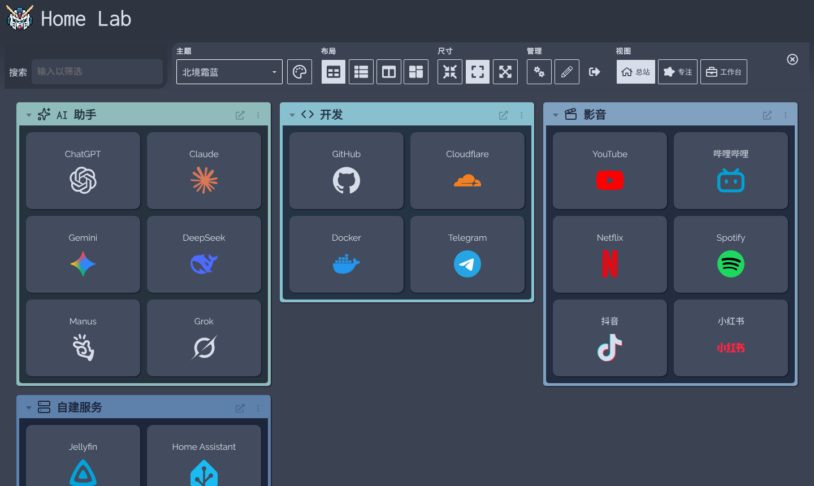
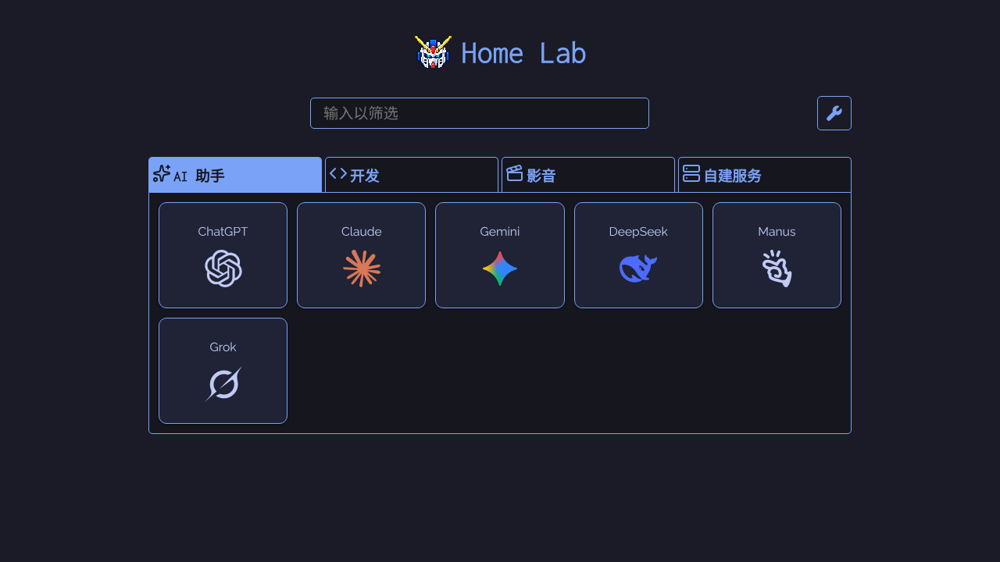
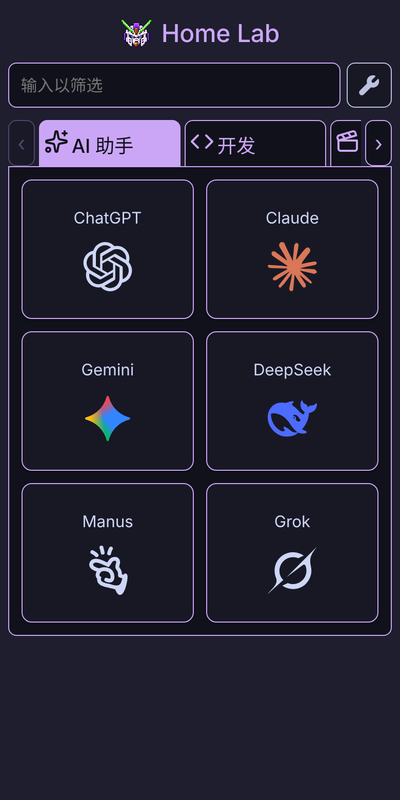

<div align="center">


# Home Lab

**One place for the websites, self-hosted services and information you use every day.**

A Chinese-first start page built on [Dashy](https://github.com/Lissy93/dashy) · Runs on Cloudflare Workers, so your desktop and phone share one configuration

[](LICENSE)
[](docs/home-lab/deployment.md)
[](docs/home-lab/architecture.md)
[](docs/home-lab/theme-readability.md)
[](https://github.com/Lissy93/dashy)

[Quick start](#-quick-start) · [Features](#-features) · [Usage](docs/home-lab/usage.md) · [FAQ](docs/home-lab/faq.md) · [Changelog](CHANGELOG.md) · [中文](README.md)



</div>

> [!NOTE]
> The interface and the linked guides are written in Chinese. This page summarizes them in English.

## ✨ Features

### 🧭 Three views, one set of bookmarks

| Overview `/home` | Focus `/minimal` | Workspace `/workspace` |
| --- | --- | --- |
| Every category, group and widget on one page | Switch categories with tabs and see only that one | Navigation on the left, the website or widget opens on the right |

<p align="center">
  
  &nbsp;
  
</p>

### 🎨 Icons: transparent, sharp and theme-aware

- **Official vector marks for brands**: more than 40 brands, including GitHub, Telegram, TikTok, Instagram, ChatGPT, Claude and DeepSeek. Transparent backgrounds, sharp at any size.
- **Single-colour marks follow the theme**: black-and-white logos such as GitHub, X, OpenAI and Manus turn light on dark themes and dark on light themes, with no white tile behind them.
- **White backgrounds removed automatically**: when a website's favicon has a white background, it is removed in a background thread (Web Worker). Photos and avatars are left as they are.
- **Sharper icon discovery**: vector icons and the largest declared size are preferred, so a 16 px favicon no longer wins.
- **Built-in icon library**: more than 1,900 icons (387 in colour), searchable by category and by Chinese or English keyword.

### ⚡ Fast: no waiting for icons after switching categories

- Categories you have visited stay mounted, so switching back is instant.
- While the browser is idle, icons of other categories are read and processed ahead of time.
- Static assets are cached long-term by content hash, so a second visit downloads almost nothing.

### ✍️ Manage everything without writing YAML

- Add, edit and drag to reorder websites and categories on the page, and preview before saving.
- **Fill in icons and descriptions**: find websites that are missing an icon or a description, read each site's own icon and English description, then review and apply.
- Every cloud save backs up the previous version, which you can restore from the configuration history.

### 🌗 61 themes, each checked for readability

- All upstream Dashy themes are included, each with a Chinese name, and you can star your favourites.
- Every theme passes a contrast audit: site names, descriptions, category tabs, the search box and workspace text reach at least 4.5:1 in all themes.
- The login page, theme menu, context menu and pixel mecha mark follow the current theme's colours.

### 📡 Service status and widgets

- HTTP checks run in the Worker; ICMP ping and system information can use your own host backend.
- All 94 upstream widgets (weather, calendar, RSS, custom API and more) are kept, with Chinese guidance on their data sources.

### ☁️ One configuration across devices

- Configuration, theme and favourites are stored in Cloudflare KV, so your desktop and phone open the same start page.
- Admin password sign-in; the admin password and widget API keys are kept in Worker Secrets, never in frontend code.

> [!NOTE]
> Some features need more than the Worker: ICMP ping and host information require an optional backend; whether the workspace can embed a website depends on that site allowing iframes; widgets need their own services and credentials. See [feature boundaries](docs/home-lab/features.md) (Chinese).

## 🚀 Quick start

All you need is a Cloudflare account. No server of your own is required.

1. **Fork** this repository, then create a Workers project in Cloudflare and connect it to the repository.
2. **Create a KV namespace** and put its ID in the build variable `HOME_KV_NAMESPACE_ID`.
3. **Set the admin password** by adding the runtime Secret `ADMIN_TOKEN`.
4. **Deploy**, and optionally bind a custom domain.
5. **Sign in**, add categories and websites, click "保存到云端" (Save to cloud), then refresh on another device to see them.

Full steps, build commands and variables are in the [deployment guide](docs/home-lab/deployment.md) (Chinese).

> [!TIP]
> Do not commit your personal website list, cookies or API keys to a public repository. They belong in your own KV and Worker Secrets.

<details>
<summary><b>Local development</b></summary>

```bash
npm ci
npm run dev      # Vite dev server (frontend only), http://localhost:8080
npm run build    # Production build into dist/
npx vitest run && node --test tests/*.test.mjs   # Frontend and Worker tests
node scripts/theme-audit/audit.mjs --fixed       # Contrast audit for all 61 themes
```

The full save and sign-in flow needs the Worker API; see the [maintenance guide](docs/home-lab/maintenance.md) (Chinese).

</details>

## 📚 Documentation

The guides below are in Chinese.

| I want to… | Read |
| --- | --- |
| Deploy, set up KV and a custom domain | [Deployment guide](docs/home-lab/deployment.md) |
| Add websites, change icons, use widgets | [Usage guide](docs/home-lab/usage.md) |
| Know whether a feature needs an API or backend | [Feature boundaries](docs/home-lab/features.md) |
| Troubleshoot saving, icons, weather or embedding | [FAQ](docs/home-lab/faq.md) |
| Understand icon transparency and sharpness rules | [Icon transparency and sharpness](docs/home-lab/icon-transparency.md) |
| See the theme contrast audit | [Theme readability audit](docs/home-lab/theme-readability.md) |
| Understand the code layout | [Architecture and file map](docs/home-lab/architecture.md) |
| Branch, verify, release and roll back | [Maintenance guide](docs/home-lab/maintenance.md) |
| Look up every change | [Changelog](CHANGELOG.md) · [Commit index](docs/home-lab/history.md) |
| Look up Dashy's original configuration fields | [Upstream docs index](docs/readme.md) (English) |

## 🧱 Tech stack and layout

**Vue 3 + Vite** frontend · **Cloudflare Workers + KV** backend and storage · **Vitest + node:test** tests

| Path | Contents |
| --- | --- |
| `src/` | Frontend: three views, themes, widgets, editor, icon processing |
| `cloud/` | Worker: sign-in, KV configuration, icon discovery and proxy, site descriptions, weather, probes |
| `public/portal-icons/` | Bundled brand icons and icon packs (sources in [SOURCES.md](public/portal-icons/SOURCES.md)) |
| `scripts/` | Brand icon generation, icon pack sync, theme audit |
| `tests/` | Frontend component, Worker API and utility tests |
| `docs/home-lab/` | User and maintenance guides for this project |

## 🤝 Contributing

Issues and pull requests are welcome. Work on a separate branch and run the test commands above before submitting; the pull request template lists what to describe about your verification. See the [contributing guide](CONTRIBUTING.md).

## 🙏 Acknowledgements

- [Dashy](https://github.com/Lissy93/dashy) is the foundation of this project. Navigation, themes, widgets and the configuration system come from Alicia Sykes and the upstream contributors; the original introduction is kept in [README_UPSTREAM.md](README_UPSTREAM.md).
- Icon sources: [Simple Icons](https://simpleicons.org/), [Lobe Icons](https://github.com/lobehub/lobe-icons), [Lucide](https://lucide.dev/), [Microsoft Fluent Emoji](https://github.com/microsoft/fluentui-emoji), [Icons8 Flat Color](https://github.com/icons8/flat-color-icons) and [QX-icons](https://github.com/chenran71ran-oss/QX-icons).

## 📄 License

[MIT](LICENSE), with the upstream copyright notice retained. Third-party icons, fonts and trademarks remain under their own licences and ownership. This is an independent fork of Dashy maintained by Kenneth ([@chenran71ran-oss](https://github.com/chenran71ran-oss)) and is not an official Dashy release.
