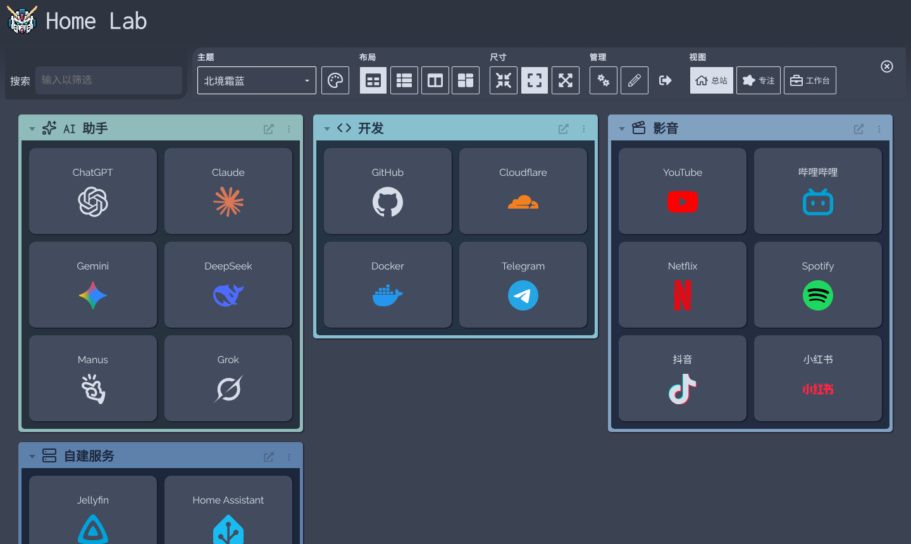
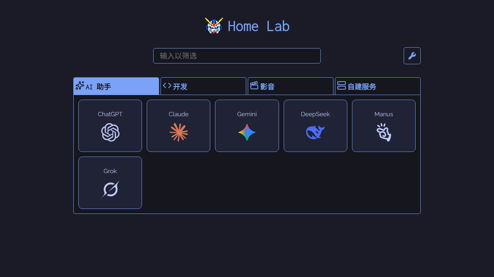
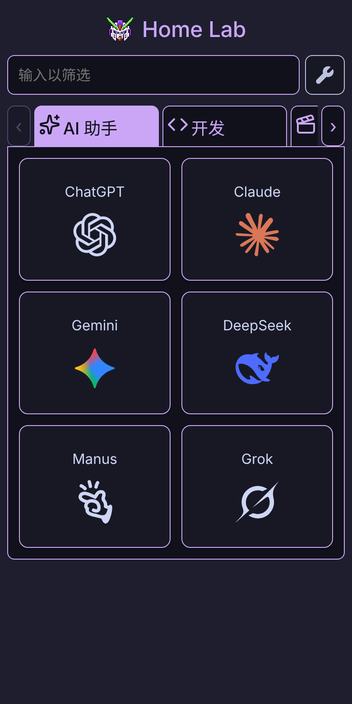

<div align="center">


# Home Lab

**一个入口，放下你的常用网站、自建服务和每天要看的信息。**

基于 [Dashy](https://github.com/Lissy93/dashy) 深度改造的中文导航主页 · 部署在 Cloudflare Workers，电脑和手机共用同一份配置

[](LICENSE)
[](docs/home-lab/deployment.md)
[](docs/home-lab/architecture.md)
[](docs/home-lab/theme-readability.md)
[](https://github.com/Lissy93/dashy)

[快速开始](#-快速开始) · [功能](#-功能亮点) · [使用指南](docs/home-lab/usage.md) · [常见问题](docs/home-lab/faq.md) · [变更日志](CHANGELOG.md) · [English](README.EN.md)



</div>

## ✨ 功能亮点

### 🧭 三种视图，同一份书签

| 总站 `/home` | 专注 `/minimal` | 工作台 `/workspace` |
| --- | --- | --- |
| 所有分类、小分类和小组件一次铺开 | 按分类标签切换，只看当前这一类 | 左侧导航，右侧直接打开网页或小组件 |

<p align="center">
  
  &nbsp;
  
</p>

### 🎨 图标：透明、清晰、跟随主题

- **品牌图标用官方矢量图**：GitHub、Telegram、抖音、Instagram、ChatGPT、Claude、DeepSeek 等 40 余个品牌，背景透明，任何尺寸都清晰。
- **单色标志跟随主题色**：GitHub、X、OpenAI、Manus 这类黑白标志，深色主题下是浅色，浅色主题下是深色，不再垫白底。
- **网站图标自动去白底**：自动读取的 favicon 如果是白底，会在后台线程（Web Worker）里去掉背景。照片和头像不处理。
- **读取更清晰的图标**：优先选择矢量图和尺寸最大的图标，不会被 16px 的小 favicon 抢先。
- **自选图库**：1900 多个内置图标（含 387 个彩色图标），按分类和中英文关键词搜索。

### ⚡ 快：切换分类不再等图标

- 访问过的分类保持挂载，切回来直接显示。
- 浏览器空闲时，提前读取并处理其他分类的图标。
- 静态资源按内容哈希长期缓存，第二次打开几乎不用重新下载。

### ✍️ 不写 YAML 也能管理

- 页面内直接添加、编辑、拖拽排序网站和分类，保存前可预览。
- **补齐图标与说明**：一键找出缺图标、缺说明的网站，读取网站自己的图标和英文描述，预览确认后再应用。
- 保存到云端时自动备份上一版，可从配置历史恢复。

### 🌗 61 个主题，每个都校准过可读性

- 包含上游 Dashy 的全部主题，均有中文名称，可收藏常用主题。
- 每个主题都经过对比度审查：网站名、说明、分类标签、搜索框、工作台文字在所有主题下都不低于 4.5:1。
- 登录页、主题菜单、右键菜单和像素机甲标识的配色跟随当前主题。

### 📡 服务状态与小组件

- HTTP 检测由 Worker 执行；ICMP Ping 和系统信息可接入自己的主机后端。
- 保留上游的 94 种小组件（天气、日历、RSS、自定义 API 等），并补充中文说明和数据源提示。

### ☁️ 一份配置，多台设备

- 配置、主题和收藏保存在 Cloudflare KV，电脑和手机打开的是同一个主页。
- 管理员密码登录；管理员密码和小组件的 API 密钥存放在 Worker Secret 中，不进前端代码。

> [!NOTE]
> 有些能力需要额外条件：ICMP Ping 和主机信息需要可选后端；工作台能否嵌入网页，取决于目标网站是否允许 iframe；小组件需要对应服务和授权。详见 [功能边界](docs/home-lab/features.md)。

## 🚀 快速开始

只需要一个 Cloudflare 账号，不需要自己的服务器。

1. **Fork** 本仓库，在 Cloudflare 中创建 Workers 项目并连接仓库。
2. **创建 KV 命名空间**，把它的 ID 填进构建变量 `HOME_KV_NAMESPACE_ID`。
3. **设置管理员密码**：添加运行时 Secret `ADMIN_TOKEN`。
4. **部署**并绑定自定义域名（可选）。
5. **登录**后添加分类和网站，点击「保存到云端」，在另一台设备上刷新即可看到。

完整步骤、构建命令和变量说明见 [部署指南](docs/home-lab/deployment.md)。

> [!TIP]
> 个人网站列表、Cookie 和 API 密钥不要提交到公开仓库。它们都保存在你自己的 KV 和 Worker Secret 中。

<details>
<summary><b>本地开发</b></summary>

```bash
npm ci
npm run dev      # Vite 开发服务器（仅前端），http://localhost:8080
npm run build    # 生产构建，输出到 dist/
npx vitest run && node --test tests/*.test.mjs   # 前端与 Worker 测试
node scripts/theme-audit/audit.mjs --fixed       # 61 个主题的对比度审查
```

完整的保存、登录流程需要 Worker API，见 [维护指南](docs/home-lab/maintenance.md)。

</details>

## 📚 文档

| 我想… | 看这里 |
| --- | --- |
| 部署、配置 KV 和自定义域名 | [部署指南](docs/home-lab/deployment.md) |
| 添加网站、换图标、用小组件 | [使用指南](docs/home-lab/usage.md) |
| 知道某个功能要不要 API 或后端 | [功能边界](docs/home-lab/features.md) |
| 排查保存、图标、天气、嵌入问题 | [常见问题](docs/home-lab/faq.md) |
| 了解图标透明化和清晰度规则 | [图标透明化与清晰度](docs/home-lab/icon-transparency.md) |
| 查看主题对比度审查结果 | [主题可读性审查](docs/home-lab/theme-readability.md) |
| 理解代码结构 | [架构与文件导航](docs/home-lab/architecture.md) |
| 分支协作、验证、上线和回滚 | [维护指南](docs/home-lab/maintenance.md) |
| 查阅每次改动 | [变更日志](CHANGELOG.md) · [提交历史索引](docs/home-lab/history.md) |
| 查 Dashy 原版配置字段 | [上游文档索引](docs/readme.md) |

## 🧱 技术栈与结构

**Vue 3 + Vite** 前端 · **Cloudflare Workers + KV** 后端与存储 · **Vitest + node:test** 测试

| 路径 | 内容 |
| --- | --- |
| `src/` | 前端：三种视图、主题、小组件、编辑器、图标处理 |
| `cloud/` | Worker：登录、KV 配置、图标读取与代理、网站描述、天气、探针 |
| `public/portal-icons/` | 内置品牌图标与图标包（来源见 [SOURCES.md](public/portal-icons/SOURCES.md)） |
| `scripts/` | 品牌图标生成、图标包同步、主题审查脚本 |
| `tests/` | 前端组件、Worker 接口与工具函数测试 |
| `docs/home-lab/` | 本项目的用户与维护文档 |

## 🤝 参与贡献

欢迎提 Issue 和 PR。改动请在独立分支进行，提交前运行上面的测试命令；PR 模板会提示需要说明的验证范围。详见 [贡献指南](CONTRIBUTING.md)。

## 🙏 致谢

- [Dashy](https://github.com/Lissy93/dashy)：本项目的基础。导航、主题、小组件和配置体系均来自 Alicia Sykes 与上游贡献者，原版介绍保留在 [README_UPSTREAM.md](README_UPSTREAM.md)。
- 图标资源：[Simple Icons](https://simpleicons.org/)、[Lobe Icons](https://github.com/lobehub/lobe-icons)、[Lucide](https://lucide.dev/)、[Microsoft Fluent Emoji](https://github.com/microsoft/fluentui-emoji)、[Icons8 Flat Color](https://github.com/icons8/flat-color-icons)、[QX-icons](https://github.com/chenran71ran-oss/QX-icons)。

## 📄 许可证

[MIT](LICENSE)，保留上游版权声明。第三方图标、字体和商标遵循各自的许可与权利归属。本项目是 Dashy 的独立 fork，由 Kenneth（[@chenran71ran-oss](https://github.com/chenran71ran-oss)）维护，不代表 Dashy 官方发布。
