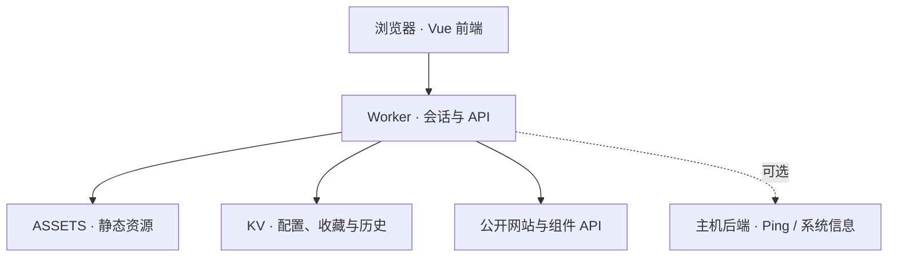

# 架构与文件导航

[文档首页](../readme.md) · [部署](deployment.md) · [贡献](../../CONTRIBUTING.md)

## 数据流

GitHub 保存代码，Workers Builds 构建部署；线上 KV 不自动提交到仓库。卡片跳转或 iframe 不代替目标网站认证。

## 文件职责

| 路径 | 作用 |
| --- | --- |
| `src/views/` | 三视图与页面 |
| `src/components/` | 卡片、状态点、小组件、编辑器 |
| `src/utils/` | 图标、主题收藏及辅助逻辑 |
| `cloud/worker.mjs` | 登录、鉴权、路由和资源入口 |
| `cloud/config-storage.mjs` | KV 配置、备份与历史 |
| `cloud/services.mjs` | HTTP、代理与主机后端适配 |
| `cloud/weather.mjs` | 天气 |
| `cloud/icon-discovery.mjs` | 图标发现与图片验证 |
| `cloud/icon-catalog.mjs` | 核实的品牌与应用图标 |
| `cloud/build-validator.mjs` | 构建期生成配置验证器 |
| `cloud/config-validator.cjs` | 构建生成的验证器 |
| `cloud/prepare-deploy.mjs` | 生成临时部署配置 |
| `public/mech/`、`public/portal-icons/` | 标识与保留许可的图标包 |
| `tests/` | 功能与组件检查 |
| `docs/home-lab/` | 本 fork 用户文档 |
| `docs/`、`README_UPSTREAM.md` | 上游参考与技术记录 |

## 数据与权限

`ADMIN_TOKEN` 用于密码认证与会话签名。会话 Cookie 使用 HttpOnly、SameSite，HTTPS 下带 Secure；有效期 12 小时，修改密码使旧签名失效。

KV 保存配置、收藏、历史和图标缓存。保存接口使用管理员会话与同源检查；公开抓取不转发总站 Cookie 或授权。代理检查目标与重定向，不提供任意私有网络访问。

配置普通字段会提供给已登录浏览器；仅供服务端使用的密钥应放 Secrets，并使用支持的占位符和代理。

## 维护原则

优先通过文档导航整理文件，不随意搬动源码、资源路径或构建配置。保留上游历史以便合并。

继承的 GitHub Actions 和维护元数据仍在 `.github/`，不等同于本 fork 发布流程，Worker 部署以 Workers Builds 为准。代码所有者、权限与发布策略变更应单独评估。
